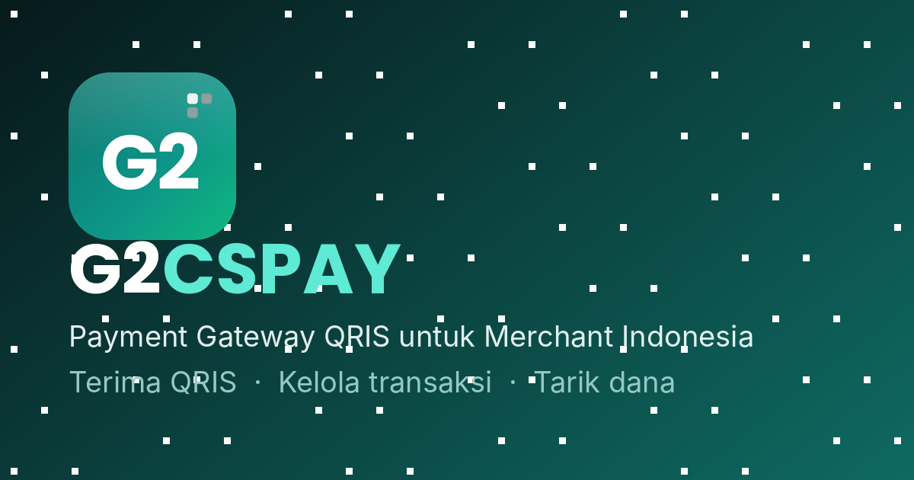

<div align="center">


### Payment Gateway QRIS self-hosted untuk merchant Indonesia

Dibangun di atas GoBiz (GoPay Merchant) milik Gojek. G2CSPAY memfasilitasi QRIS dinamis dan auto-matching pembayaran — **bukan PJP resmi**.

<p>
  <a href="https://nuxt.com/">
    
  </a>
  <a href="https://vuejs.org/">
    
  </a>
  <a href="https://expressjs.com/">
    
  </a>
  <a href="https://nodejs.org/">
    
  </a>
  <a href="https://www.postgresql.org/">
    
  </a>
  <a href="https://vercel.com/">
    
  </a>
  
</p>



</div>

---

## Daftar Isi

- [Fitur](#fitur)
- [Kredensial API](#kredensial-api)
- [Arsitektur](#arsitektur)
- [Deploy ke Vercel dan Neon](#deploy-ke-vercel-dan-neon)
- [Deploy ke VPS Ubuntu](#deploy-ke-vps-ubuntu)
- [Cron Auto-Poll](#cron-auto-poll)
- [API v1](#api-v1)
- [Webhook](#webhook)
- [Sandbox](#sandbox)
- [Contoh Integrasi](#contoh-integrasi)
- [Environment Variables](#environment-variables)
- [Troubleshooting](#troubleshooting)
- [Struktur Proyek](#struktur-proyek)
- [Kontribusi](#kontribusi)
- [Lisensi](#lisensi)

---

## Fitur

| Fitur                       | Deskripsi                                                                                                                                          |
| --------------------------- | -------------------------------------------------------------------------------------------------------------------------------------------------- |
| **QRIS Dinamis**            | Nominal pembayaran ter-encode di QR dan auto-matching melalui polling GoBiz.                                                                       |
| **Dashboard Merchant Live** | Grafik volume transaksi 7/30/90 hari, saldo settled/pending, dan notifikasi real-time.                                                             |
| **1 Credential API Key**    | Cukup satu API Key full akses per environment — production dan sandbox terpisah, regenerate dan delete dari dashboard.                             |
| **Penarikan Dana**          | Fee persentase + flat yang dapat dikonfigurasi dari admin panel, bank picker 25+ bank Indonesia dengan logo, serta penyimpanan rekening.           |
| **2FA TOTP**                | Two-factor authentication menggunakan Google Authenticator dengan toggle aktif/nonaktif dari profil.                                               |
| **Panel Admin**             | Kelola user, ban/unban, transaksi, approval withdrawal, fee transaksi, minimum/fee withdrawal, branding, maintenance mode, dan override logo bank. |
| **Sandbox**                 | API Key `SB-rp_live_` menggunakan tabel `transactions_sandbox` terpisah tanpa polling GoBiz dan tanpa uang asli.                                 |
| **Interactive Docs**        | Dokumentasi interaktif di `/docs` dengan contoh cURL, Node.js, PHP, dan Python serta base URL otomatis dari environment.                           |
| **Maintenance Mode**        | Halaman maintenance khusus tanpa menghentikan pembayaran QRIS maupun webhook.                                                                      |
| **Notifikasi**              | Notifikasi in-app dan email menggunakan Resend.                                                                                                    |

---

## Kredensial API

Cukup **1 credential** untuk full akses: **API Key**. Konsep Client Key / Server Key terpisah sudah dihapus.

| Lingkungan | Prefix API Key       | Base path      |
| ---------- | -------------------- | -------------- |
| Production | `rp_live_...`      | `/api/v1`      |
| Sandbox    | `SB-rp_live_...`   | `/api/sandbox` |

- Buat dan regenerate API Key dari dashboard merchant → menu **API Key**.
- API Key dikirim sebagai HTTP Basic (API Key sebagai username, password kosong):

```bash
curl -u "$API_KEY:" "https://pay.domainmu.com/api/balance"
```

atau sebagai Bearer token:

```http
X-API-Key: rp_live_xxxxxxxxxxxxxxxxxxxx
```

- API Key lama berawalan `CSPay-Server-` **tetap valid** (backward compatible).

---

## Arsitektur

```text
┌───────────────────────┐
│    Merchant Server    │
└───────────┬───────────┘
            │
            │ POST /api/v1/charge
            │ X-API-Key: rp_live_xxxxxxxxxxxxxxxxxxxx
            ▼
┌───────────────────────────────┐
│            G2CSPAY             │
│         Vercel / VPS          │
│                               │
│    API → Payment Logic → DB   │
└───────────┬───────────────────┘
            │
            │ qr_string / payment_url
            ▼
┌───────────────────────┐
│   Customer / Buyer    │
│       Scan QRIS       │
└───────────┬───────────┘
            │
            │ Payment
            ▼
┌───────────────────────┐
│         GoBiz         │
│     GoPay Merchant    │
└───────────┬───────────┘
            │
            │ Polling
            ▼
┌───────────────────────────────┐
│        G2CSPAY Poller          │
│      Auto-match transaksi     │
└───────────┬───────────────────┘
            │
            │ POST callback_url
            │ X-Signature: HMAC-SHA256
            ▼
┌───────────────────────┐
│    Merchant Webhook   │
└───────────────────────┘
```

---

## Deploy ke Vercel dan Neon

### 1. Buat database PostgreSQL

Buat project PostgreSQL di [Neon](https://neon.tech/) lalu copy connection string yang diberikan.

Import skema — pilih salah satu:

- Jalankan `npm run migrate` sekali dari komputer lokal dengan `DATABASE_URL` mengarah ke Neon (idempoten, aman dijalankan ulang), atau
- Import `migrations/schema.sql` melalui **Neon SQL Editor**.

### 2. Import repository ke Vercel

Fork repository G2CSPAY:

```text
https://github.com/RONI-PROJECT/G2CSPAY
```

Kemudian import repository tersebut ke [Vercel](https://vercel.com/).

### 3. Set environment variables

Masukkan environment variables pada:

```text
Vercel → Project → Settings → Environment Variables
```

Minimal production:

```env
DATABASE_URL=postgresql://...
PUBLIC_URL=https://pay.domainmu.com
PUBLIC_API_BASE_URL=https://pay.domainmu.com
QRIS_STRING=...
GOPAY_EMAIL=...
GOPAY_PASSWORD=...
API_KEY=rp_live_xxxxxxxxxxxxxxxxxxxx
WEBHOOK_SECRET=...
ADMIN_USERNAME=...
ADMIN_PASSWORD=...
```

### 4. Deploy

Klik **Deploy** dan tunggu proses build selesai.

Aplikasi:

```text
https://pay.domainmu.com
```

Panel admin:

```text
https://pay.domainmu.com/panel/login
```

---

## Deploy ke VPS Ubuntu

Requirement: **Ubuntu 22.04**, **Node.js 22+**, **PostgreSQL**, **Nginx**.

### Install dependency

```bash
curl -fsSL https://deb.nodesource.com/setup_22.x | bash -
apt install -y nodejs postgresql nginx certbot python3-certbot-nginx
```

### Buat database PostgreSQL

```bash
sudo -u postgres psql
```

Kemudian:

```sql
CREATE DATABASE g2cspay;
CREATE USER uno WITH ENCRYPTED PASSWORD 'GANTI_PASSWORD_DATABASE';
GRANT ALL PRIVILEGES ON DATABASE g2cspay TO uno;
```

Keluar:

```sql
\q
```

### Clone repository

```bash
cd /var/www
git clone https://github.com/RONI-PROJECT/G2CSPAY.git
cd G2CSPAY
```

### Install dependency

```bash
npm install
```

### Setup environment

```bash
cp .env.example .env
nano .env
```

Isi `DATABASE_URL` dengan kredensial database di atas, lalu lengkapi variable lainnya sesuai konfigurasi server.

### Apply skema database

```bash
npm run migrate
```

### Build dan jalankan PM2

```bash
npm run build
npm i -g pm2
pm2 start ecosystem.config.cjs
pm2 save
pm2 startup
```

### Nginx reverse proxy

Contoh konfigurasi:

```nginx
server {
    listen 80;
    server_name pay.domainmu.com;

    location / {
        proxy_pass http://127.0.0.1:3000;

        proxy_set_header Host $host;
        proxy_set_header X-Real-IP $remote_addr;
        proxy_set_header X-Forwarded-For $proxy_add_x_forwarded_for;
        proxy_set_header X-Forwarded-Proto $scheme;
    }
}
```

Test konfigurasi:

```bash
nginx -t
systemctl reload nginx
```

### SSL dengan Certbot

```bash
certbot --nginx -d pay.domainmu.com
```

---

## Cron Auto-Poll

Untuk production, jalankan polling secara berkala agar transaksi tetap dapat di-match walaupun halaman pembayaran customer tidak sedang dibuka.

| Setting            | Nilai                                    |
| ------------------ | ---------------------------------------- |
| **Method**         | `POST`                                   |
| **Endpoint**       | `/api/admin/poll`                        |
| **Interval**       | Setiap 1 menit                           |
| **Authentication** | `X-API-Key: rp_live_xxxxxxxxxxxxxxxxxxxx
| **Tujuan**         | Menjalankan polling GoBiz secara berkala |

Contoh:

```bash
curl -X POST "https://pay.domainmu.com/api/admin/poll" \
  -H "Authorization: Bearer ${API_KEY}"
```

### Crontab VPS

Buka crontab:

```bash
crontab -e
```

Tambahkan:

```cron
* * * * * curl -s -X POST "https://pay.domainmu.com/api/admin/poll" -H "Authorization: Bearer $API_KEY" >/dev/null 2>&1
```

Tanpa cron, pembayaran tetap dapat terdeteksi ketika customer membuka halaman bayar karena menggunakan **request-driven polling**.

Namun, cron tetap disarankan karena menjamin proses matching tetap berjalan meskipun halaman pembayaran tidak dibuka.

---

## API v1

Autentikasi: API Key sebagai HTTP Basic (username) atau `X-API-Key: rp_live_xxxxxxxxxxxxxxxxxxxx

| Method | Endpoint                                              | Fungsi                    |
| ------ | ----------------------------------------------------- | ------------------------- |
| POST   | `/api/v1/charge`                                      | Buat transaksi QRIS       |
| GET    | `/api/v1/transaction/{order_id}/status`                | Cek status                |
| GET    | `/api/v1/transaction/{order_id}/qr`                    | Gambar QR (PNG)           |
| POST   | `/api/v1/transaction/{order_id}/cancel`                | Batalkan transaksi pending |
| POST   | `/api/v1/transaction/{order_id}/notification/resend`   | Kirim ulang notifikasi    |

Buat transaksi:

```bash
curl -X POST "https://pay.domainmu.com/api/v1/charge" \
  -u "$API_KEY:" -H "Content-Type: application/json" \
  -d '{
    "payment_type": "qris",
    "transaction_details": { "order_id": "ORDER-123", "gross_amount": 25000 },
    "callback_url": "https://toko.com/webhook"
  }'
```

Response `201`:

```json
{
  "status_code": "201",
  "status_message": "Menunggu pembayaran",
  "transaction_id": "G2CSPAY-xxxxxxxxxxxx",
  "order_id": "ORDER-123",
  "gross_amount": "25000.00",
  "fee_amount": "450.00",
  "net_amount": "24550.00",
  "pay_amount": "25000.00",
  "currency": "IDR",
  "payment_type": "qris",
  "transaction_status": "pending",
  "fraud_status": "accept",
  "qr_string": "00020101021126610...",
  "payment_url": "https://pay.domainmu.com/pay/G2CSPAY-xxxxxxxxxxxx",
  "actions": [
    {
      "name": "generate-qr-code",
      "method": "GET",
      "url": "https://pay.domainmu.com/api/transaction/G2CSPAY-xxxxxxxxxxxx/qr"
    }
  ]
}
```

- `payment_url` — halaman bayar siap pakai untuk customer.
- `qr_string` — string QRIS dinamis, render sendiri sebagai QR jika mau.
- `actions` — endpoint gambar QR (PNG) siap tampilkan.

---

## Webhook

Jika `callback_url` diberikan ketika membuat QRIS, G2CSPAY akan mengirim webhook ketika payment berubah menjadi:

```text
settlement
expire
```

Request dikirim ke:

```http
POST https://toko.com/webhook
```

### Payload `settlement`

```json
{
  "event": "settlement",
  "data": {
    "reference": "ORDER-123",
    "status": "PAID",
    "payment_method": "QRIS",
    "amount": 50000,
    "fee": 900,
    "net": 49100,
    "currency": "IDR",
    "paid_at": "2026-10-15T07:05:00.000Z",
    "metadata": {}
  }
}
```

### Headers

```http
X-Event: settlement
X-Reference: ORDER-123
X-Signature: <HMAC-SHA256>
```

`X-Signature` dihitung menggunakan:

```text
HMAC-SHA256(rawBody, WEBHOOK_SECRET)
```

Output signature berupa hexadecimal.

G2CSPAY akan melakukan retry sebanyak **12 kali** menggunakan exponential backoff.

### Verifikasi Webhook — Node.js

```js
import crypto from 'crypto'

const expected = crypto
  .createHmac('sha256', process.env.WEBHOOK_SECRET)
  .update(req.body)
  .digest('hex')

if (
  !crypto.timingSafeEqual(
    Buffer.from(expected),
    Buffer.from(req.headers['x-signature'] || '')
  )
) {
  return res.status(403).send('invalid signature')
}
```

> **Penting:** gunakan `express.raw({ type: 'application/json' })` agar HMAC dihitung menggunakan raw body yang sama persis dengan body yang dikirim G2CSPAY.

---

## Sandbox

API Key sandbox berawalan `SB-rp_live_`, production `rp_live_` — cukup 1 credential (Client Key sudah dihapus). Key lama berawalan `CSPay-Server-` tetap valid. Base path sandbox: `/api/sandbox`.

| Method | Endpoint                                                   |
| ------ | ---------------------------------------------------------- |
| POST   | `/api/sandbox/charge`                                      |
| GET    | `/api/sandbox/transaction/{order_id}/status`               |
| GET    | `/api/sandbox/transaction/{order_id}/qr`                   |
| POST   | `/api/sandbox/transaction/{order_id}/pay` (simulasi bayar)  |
| POST   | `/api/sandbox/transaction/{order_id}/expire` (simulasi expire) |
| POST   | `/api/sandbox/transaction/{order_id}/cancel`               |
| POST   | `/api/sandbox/transaction/{order_id}/notification/resend`  |

Data disimpan di `transactions_sandbox`, tanpa polling GoBiz dan tanpa uang asli. Alat uji: `/test` dan menu Sandbox di dashboard.

---

## Contoh Integrasi

Gunakan environment variables berikut:

```env
G2CSPAY_URL=https://pay.domainmu.com
G2CSPAY_API_KEY=rp_live_xxxxxxxxxxxxxxxxxxxx
```

### PHP

```php
<?php

$baseUrl = getenv('G2CSPAY_URL');
$apiKey  = getenv('G2CSPAY_API_KEY');

$payload = [
    'payment_type' => 'qris',
    'transaction_details' => [
        'order_id'     => 'ORDER-123',
        'gross_amount' => 50000,
    ],
    'callback_url'  => 'https://toko.com/webhook',
    'custom_expiry' => ['expiry_duration' => 15, 'unit' => 'minute'],
    'metadata'      => ['produk' => 'Kaos Online'],
];

$ch = curl_init($baseUrl . '/api/v1/charge');

curl_setopt_array($ch, [
    CURLOPT_POST           => true,
    CURLOPT_RETURNTRANSFER => true,
    CURLOPT_USERPWD        => $apiKey . ':',
    CURLOPT_HTTPHEADER     => ['Content-Type: application/json'],
    CURLOPT_POSTFIELDS     => json_encode($payload)
]);

$response = curl_exec($ch);

if ($response === false) {
    throw new Exception(curl_error($ch));
}

curl_close($ch);

$trx = json_decode($response, true);

echo $trx['payment_url'] ?? '';
echo $trx['qr_string']   ?? '';
```

### Node.js

```js
const baseUrl = process.env.G2CSPAY_URL
const apiKey = process.env.G2CSPAY_API_KEY

const response = await fetch(`${baseUrl}/api/v1/charge`, {
  method: 'POST',
  headers: {
    'Authorization': `Basic ${Buffer.from(`${apiKey}:`).toString('base64')}`,
    'Content-Type': 'application/json'
  },
  body: JSON.stringify({
    payment_type: 'qris',
    transaction_details: {
      order_id: 'ORDER-123',
      gross_amount: 50000
    },
    callback_url: 'https://toko.com/webhook',
    custom_expiry: { expiry_duration: 15, unit: 'minute' },
    metadata: {}
  })
})

const trx = await response.json()

console.log(trx.payment_url)
console.log(trx.qr_string)
```

### Python

```python
import os
import requests

base_url = os.environ["G2CSPAY_URL"]
api_key = os.environ["G2CSPAY_API_KEY"]

payload = {
    "payment_type": "qris",
    "transaction_details": {
        "order_id": "ORDER-123",
        "gross_amount": 50000
    },
    "callback_url": "https://toko.com/webhook",
    "custom_expiry": {"expiry_duration": 15, "unit": "minute"},
    "metadata": {}
}

response = requests.post(
    f"{base_url}/api/v1/charge",
    auth=(api_key, ""),
    json=payload,
    timeout=30
)

response.raise_for_status()

trx = response.json()

print(trx["payment_url"])
print(trx["qr_string"])
```

---

## Environment Variables

### Wajib

| Variable              | Deskripsi                                                                     |
| --------------------- | ----------------------------------------------------------------------------- |
| `DATABASE_URL`        | PostgreSQL connection string untuk Neon atau PostgreSQL VPS.                  |
| `PUBLIC_URL`          | URL publik aplikasi yang digunakan pada `qr_image` dan docs.                  |
| `PUBLIC_API_BASE_URL` | Base URL API publik.                                                          |
| `QRIS_STRING`         | String QRIS statis GoBiz.                                                     |
| `GOPAY_EMAIL`         | Email akun GoBiz.                                                             |
| `GOPAY_PASSWORD`      | Password akun GoBiz.                                                          |
| `API_KEY`             | Static key fallback.                                                          |
| `WEBHOOK_SECRET`      | Secret HMAC untuk verifikasi webhook.                                         |
| `ADMIN_USERNAME`      | Username panel admin.                                                         |
| `ADMIN_PASSWORD`      | Password panel admin.                                                         |

Generate `WEBHOOK_SECRET`:

```bash
openssl rand -hex 32
```

### Opsional

| Variable                         | Deskripsi                                                                 |
| -------------------------------- | ------------------------------------------------------------------------- |
| `GOPAY_MERCHANT_ID`              | Merchant ID GoPay/GoBiz.                                                  |
| `NUXT_PUBLIC_TURNSTILE_SITE_KEY` | Site key Cloudflare Turnstile.                                            |
| `TURNSTILE_SECRET_KEY`           | Secret key Cloudflare Turnstile.                                          |
| `EXPIRE_MINUTES`                 | Durasi expiry default. Default `5`.                                       |
| `POLL_MIN_INTERVAL_MS`           | Interval minimum polling dalam milidetik. Default `7000`, minimum `7000`. |
| `SANDBOX_MODE`                   | Mode sandbox: `0` atau `1`.                                               |
| `TRUST_PROXY`                    | Isi `1` jika aplikasi berada di balik proxy.                              |
| `PORT`                           | Port aplikasi. Default `3000`.                                            |

Contoh `.env`:

```env
DATABASE_URL=postgresql://...

PUBLIC_URL=https://pay.domainmu.com
PUBLIC_API_BASE_URL=https://pay.domainmu.com

QRIS_STRING=...

GOPAY_EMAIL=...
GOPAY_PASSWORD=...

API_KEY=rp_live_xxxxxxxxxxxxxxxxxxxx
WEBHOOK_SECRET=...

ADMIN_USERNAME=admin
ADMIN_PASSWORD=...

GOPAY_MERCHANT_ID=...

NUXT_PUBLIC_TURNSTILE_SITE_KEY=...
TURNSTILE_SECRET_KEY=...

EXPIRE_MINUTES=5
POLL_MIN_INTERVAL_MS=7000
SANDBOX_MODE=0
TRUST_PROXY=1
PORT=3000
```

---

## Troubleshooting

| Masalah                                | Solusi                                                                                                           |
| -------------------------------------- | ---------------------------------------------------------------------------------------------------------------- |
| `FUNCTION_INVOCATION_FAILED` di Vercel | Periksa environment variables, terutama `DATABASE_URL` dan `QRIS_STRING`.                                        |
| `unauthorized` pada API v1             | Pastikan API key benar, belum expired, dan masih active. Cek dashboard Kredensial.                               |
| `reference_already_exists`             | Ganti `reference`, atau retry menggunakan header `idempotency-key` yang sama.                                    |
| Pembayaran tidak ke-match              | Pastikan cron polling berjalan dan API key untuk polling sudah benar.                                            |
| Webhook tidak diterima                 | Pastikan `callback_url` adalah HTTPS publik dan verifikasi `X-Signature` menggunakan `WEBHOOK_SECRET` yang sama. |
| Session GoBiz expired                  | Session akan melakukan re-auth otomatis. Cek `/api/health` → `data.session.ok`.                                  |
| Build error di Termux/sdcard           | Pindahkan project ke storage internal karena storage SD card dapat memiliki masalah `noexec`.                    |

Health check:

```text
https://pay.domainmu.com/api/health
```

---

## Struktur Proyek

```text
G2CSPAY/
├── src/
│   ├── app.js                 # Express + route mounting
│   ├── config.js              # Env config
│   ├── security.js            # Bearer auth, rate limit, HMAC, SSRF guard
│   │
│   ├── routes/
│   │   ├── payments.js        # API v1 — /api/v1/charge
│   │   ├── public.js          # /api/public/* (settings, stats)
│   │   ├── auth.js            # Login, register, 2FA
│   │   ├── user-payments.js   # Dashboard merchant
│   │   ├── admin.js           # Admin + poll
│   │   └── sandbox.js         # Sandbox
│   │
│   ├── services/
│   │   ├── payments.js        # Business logic transaksi
│   │   ├── poller.js          # GoBiz polling engine
│   │   ├── webhooks.js        # Webhook delivery + retry
│   │   ├── session.js         # GoBiz session manager
│   │   └── notifications.js
│   │
│   └── db/
│
├── migrations/
│   └── schema.sql             # Skema database — apply via `npm run migrate`
│
├── public/                    # Logo, favicon, og-image, sandbox tester (/test)
│
├── web/                       # Nuxt frontend
│   ├── pages/                 # Landing, docs, merchant, panel, pay
│   ├── components/
│   └── composables/
│
└── ecosystem.config.cjs       # Konfigurasi PM2
```

---

## Kontribusi

Kontribusi dipersilakan.

1. Fork repository G2CSPAY.
2. Buat branch baru untuk perubahan.
3. Implementasikan perubahan tanpa merusak API v1 yang sudah ditetapkan.
4. Gunakan sandbox untuk pengujian integrasi.
5. Pastikan perubahan sudah ditest sebelum membuat Pull Request.
6. Buat Pull Request dengan deskripsi perubahan yang jelas.

Repository:

```text
https://github.com/RONI-PROJECT/G2CSPAY
```

---

## Lisensi

G2CSPAY dirilis di bawah lisensi **MIT**.

```text
MIT © 2026 G2CSPAY
```

---

<div align="center">

Dibuat dengan ❤️ untuk merchant Indonesia

**Jika G2CSPAY membantu project kamu, jangan lupa kasih ⭐ Star di repository.**

</div>
